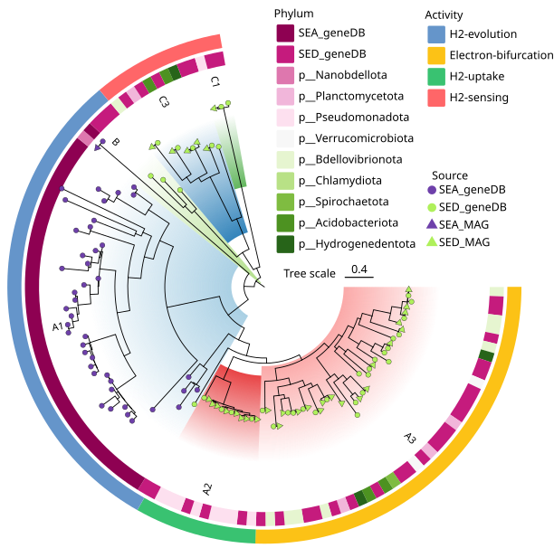
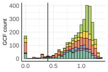
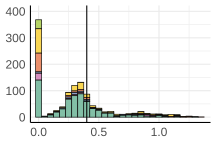

# MAG annotation

**Aim:** annotate the metabolic and biosynthetic potential of sediment and seawater MAGs, and compare gene copy numbers between habitats.

Related manuscript content: Figs 3 to 5; Tables S10 to S22.

Scripts for this analysis are in the [`scripts/`](scripts/) folder (`5.01` to `5.14`).

| Step | Script | Description |
|---|---|---|
| 5.01 | [`scripts/5.01_dram_annotate_array.sh`](scripts/5.01_dram_annotate_array.sh) | DRAM annotation (KOfam, Pfam, MEROPS) and gene prediction, one task per MAG |
| 5.02 | [`scripts/5.02_dbcan_array.sh`](scripts/5.02_dbcan_array.sh) | CAZymes, CAZyme gene clusters (CGCs), and dbCAN-PUL substrates with run_dbcan `easy_substrate` |
| 5.03 | [`scripts/5.03_sulfatlas_array.sh`](scripts/5.03_sulfatlas_array.sh) | Sulphatases with DIAMOND blastp against SulfAtlas |
| 5.04 | [`scripts/5.04_hyddb_marker_genes_array.sh`](scripts/5.04_hyddb_marker_genes_array.sh) | Hydrogenases (HydDB) and 44 metabolic marker genes with DIAMOND blastp |
| 5.05 | [`scripts/5.05_amoa_graftm_array.sh`](scripts/5.05_amoa_graftm_array.sh) | *amoA* detection and clade assignment with GraftM |
| 5.06 | [`scripts/5.06_collect_annotations.py`](scripts/5.06_collect_annotations.py) | One table per annotation type (genome, annotation) |
| 5.07 | [`scripts/5.07_enrichment_mannwhitney.py`](scripts/5.07_enrichment_mannwhitney.py) | Gene copy number comparison between habitats for KOs, Pfams, MEROPS, CAZymes, CGC substrates, and SulfAtlas (Mann-Whitney U, Benjamini-Hochberg) |
| 5.08 | [`scripts/5.08_marker_gene_enrichment.R`](scripts/5.08_marker_gene_enrichment.R) | Metabolic marker gene and HydDB subgroup copy number comparison between habitats (Mann-Whitney U, Benjamini-Hochberg) |
| 5.09 | [`scripts/5.09_antismash_array.sh`](scripts/5.09_antismash_array.sh) | Biosynthetic gene clusters (BGCs) with antiSMASH, per dataset (sediment, seawater, OMD) |
| 5.10 | [`scripts/5.10_bgc_protein_sets.sh`](scripts/5.10_bgc_protein_sets.sh) | BGC metadata and protein sequences of BGCs ≥ 5 kbp per dataset (OMD restricted to dereplicated genomes); MIBiG renamed |
| 5.11 | [`scripts/5.11_clustomatic.sh`](scripts/5.11_clustomatic.sh) | Gene cluster families (GCFs) with clust-o-matic (threshold 0.5), using [`clustomatic.modified.py`](scripts/clustomatic.modified.py) (output folder and threads added; reconstructed) |
| 5.12 | [`scripts/5.12_gcf_summary.sh`](scripts/5.12_gcf_summary.sh) | GCF table per BGC, GCF x dataset count matrix, and BGCs and GCFs per dataset |
| 5.13 | [`scripts/5.13_bigslice_gcf_distance.sh`](scripts/5.13_bigslice_gcf_distance.sh) | BiG-SLiCE features and distance of each BGC to its nearest GCF model ([`perform_l2norm_clustering.py`](scripts/perform_l2norm_clustering.py), from the OMD scripts) |
| 5.14 | [`scripts/5.14_gcf_bigfam_distance.R`](scripts/5.14_gcf_bigfam_distance.R) | Mean distance of each GCF to BiG-FAM, novel GCFs (> 0.4), and distance histograms (Fig. 5) |

## Table of contents
1. [DRAM](#dram)
2. [CAZymes and CGCs](#cazymes)
3. [Sulphatases](#sulphatases)
4. [Hydrogenases and metabolic marker genes](#markers)
5. [*amoA*](#amoa)
6. [Enrichment tests](#enrichment)
7. [Biosynthetic gene clusters](#bgcs)

## 1. DRAM <a name="dram"></a>
Directory: [`1_DRAM/`](1_DRAM/)

- DRAM v1.5 `annotate` with KOfam, Pfam, and MEROPS databases; DRAM's predicted proteins and gene coordinates are used in sections 2 to 4
- Platform: Bash (SLURM array, one task per MAG)
- Input: 1,201 sediment and 876 seawater MAGs (see [MAG recovery](../4_MAGs/4_MAG_recovery.md)), listed one FASTA per line
- Output: per-MAG annotations (`annotations.tsv`), proteins (`genes.faa`), and gene coordinates (`genes.gff`)
- Script: [`5.01_dram_annotate_array.sh`](scripts/5.01_dram_annotate_array.sh)

## 2. CAZymes and CGCs <a name="cazymes"></a>
Directory: [`2_CAZymes_CGCs/`](2_CAZymes_CGCs/)

- run_dbcan v5.0.1 `easy_substrate`: CAZyme families, CAZyme gene clusters (CGCs), and CGC substrates inferred from similarity to polysaccharide utilisation loci (PULs) in dbCAN-PUL
- Platform: Bash (SLURM array, one task per MAG)
- Output: Fig. 4, Table S20
- Script: [`5.02_dbcan_array.sh`](scripts/5.02_dbcan_array.sh)

## 3. Sulphatases <a name="sulphatases"></a>
Directory: [`3_sulphatases/`](3_sulphatases/)

- DIAMOND blastp v2.1.0 against SulfAtlas v2.3.1 (E-value 1e-20, best hit per protein)
- Platform: Bash (SLURM array, one task per MAG)
- Script: [`5.03_sulfatlas_array.sh`](scripts/5.03_sulfatlas_array.sh)

## 4. Hydrogenases and metabolic marker genes <a name="markers"></a>
Directory: [`4_hydrogenases_marker_genes/`](4_hydrogenases_marker_genes/)

- HydDB (DIAMOND blastp v2.1.0): best hit per protein with class-specific identity thresholds ([NiFe] Group 4 > 50%, other [NiFe] > 30%, [FeFe] > 45%, [Fe] > 50%), giving 30 hydrogenase subgroups
- 44 metabolic marker genes (DIAMOND blastp v2.1.0): gene-specific identity thresholds as in the [gene-centric analysis](../../1_gene_centric/2_Protein/2_Protein.md#annotation); hits kept if alignment length ≥ 40 amino acids or query or subject coverage ≥ 80%, then the best hit per protein across databases (lowest E-value)
- Platform: Bash (SLURM array, one task per MAG)
- Output: Fig. 3a-b and 3d, Table S16
- Script: [`5.04_hyddb_marker_genes_array.sh`](scripts/5.04_hyddb_marker_genes_array.sh)

<p align="center">
  <a href="./4_hydrogenases_marker_genes/FeFeHydrogenage_MLtree.svg">
    
  </a>
  <br>
  <em>Maximum-likelihood tree of [FeFe] hydrogenases. </em>
</p>

*Minimum 200 aa. Alignment using mafft, and tree inference using IQtree2*

## 5. *amoA* <a name="amoa"></a>
Directory: [`5_amoA/`](5_amoA/)

- GraftM v0.15.1 (package 7.22) on MAG nucleotide sequences, to identify *amoA* and assign bacterial or archaeal clades
- Platform: Bash (SLURM array, one task per MAG)
- Output: Table S18
- Script: [`5.05_amoa_graftm_array.sh`](scripts/5.05_amoa_graftm_array.sh)

## 6. Enrichment tests <a name="enrichment"></a>
Directory: [`6_enrichment_tests/`](6_enrichment_tests/)

- Annotations collected into one table per type: KOs, Pfams, MEROPS peptidases, CAZyme families (one row per family for multi-family proteins), CGC substrates (dbCAN-PUL), SulfAtlas families, HydDB subgroups, and the 44 marker genes
- Marker genes: database names converted to gene names, generic [NiFe] and [FeFe] hydrogenase databases replaced by HydDB subgroups, and genes with no copies in any MAG not tested
- Gene copy numbers in 796 highly complete MAGs (CheckM2 completeness ≥ 85%; 347 sediment, 449 seawater) compared between habitats with two-sided Mann-Whitney U tests and Benjamini-Hochberg correction, per annotation type
- Platform: Python (pandas, SciPy) and R
- Input: outputs of sections 1 to 4; table of the 796 MAGs and their habitat (`Entry`, `Source`)
- Output: Fig. 3b, Tables S10 to S15 and S19
- Scripts: [`5.06_collect_annotations.py`](scripts/5.06_collect_annotations.py), [`5.07_enrichment_mannwhitney.py`](scripts/5.07_enrichment_mannwhitney.py), [`5.08_marker_gene_enrichment.R`](scripts/5.08_marker_gene_enrichment.R)

```bash
python 2_genome_centric/5_MAGsAnnot/scripts/5.06_collect_annotations.py \
    --dram 1_DRAM --dbcan 2_CAZymes_CGCs --sulf 3_sulphatases \
    --hyddb 4_hydrogenases_marker_genes/hyddb --marker 4_hydrogenases_marker_genes/marker_best_hits \
    --outdir 6_enrichment_tests/annotations

for annot in ko pfam merops cazy substrate sulfatlas; do
    python 2_genome_centric/5_MAGsAnnot/scripts/5.07_enrichment_mannwhitney.py \
        --annotation 6_enrichment_tests/annotations/${annot}.tsv \
        --groups 6_enrichment_tests/genome_group_comp85.tsv \
        --out 6_enrichment_tests/${annot}_mannwhitney.csv
done

Rscript 2_genome_centric/5_MAGsAnnot/scripts/5.08_marker_gene_enrichment.R   # marker genes and HydDB subgroups
```

## 7. Biosynthetic gene clusters <a name="bgcs"></a>
Directory: [`7_BGCs/`](7_BGCs/)

- antiSMASH v6.1.1 (Prodigal gene finding, minimum contig length 5 kbp) on sediment and seawater MAGs and OMD genomes; OMD BGCs are restricted to the 8,422 OMD genomes dereplicated at 95% ANI; BGCs of 3,899 dereplicated Reef Microbiomics Database (RMD) MAGs are taken from the antiSMASH output published with the RMD ([Wiederkehr et al., 2026](https://doi.org/10.1038/s41586-026-10159-6))
- Protein sequences of BGCs ≥ 5 kbp, with MIBiG v4.0 BGCs, grouped into gene cluster families (GCFs) with [clust-o-matic](https://github.com/Helmholtz-HIPS/clustomatic_source) (threshold 0.5); natural product classes as defined in BiG-SCAPE
- Number of BGCs from each dataset in each GCF, and GCFs shared between datasets
- Novelty from L2-normalised BiG-SLiCE distances to BiG-FAM; a GCF is novel if the mean distance of its BGCs to their closest BiG-FAM GCFs is > 0.4 (BiG-SLiCE v1.1.1 and the OMD L2-norm clustering script; how BiG-FAM enters the calculation: TODO)
- Platform: Bash (SLURM) and R
- Output: Fig. 5, Tables S21 and S22
- Scripts: [`5.09_antismash_array.sh`](scripts/5.09_antismash_array.sh), [`5.10_bgc_protein_sets.sh`](scripts/5.10_bgc_protein_sets.sh), [`5.11_clustomatic.sh`](scripts/5.11_clustomatic.sh), [`5.12_gcf_summary.sh`](scripts/5.12_gcf_summary.sh), [`5.13_bigslice_gcf_distance.sh`](scripts/5.13_bigslice_gcf_distance.sh), [`5.14_gcf_bigfam_distance.R`](scripts/5.14_gcf_bigfam_distance.R)

```bash
sbatch --export=ALL,DATASET=IMOS_SED --array=1-25  2_genome_centric/5_MAGsAnnot/scripts/5.09_antismash_array.sh
sbatch --export=ALL,DATASET=IMOS_SEA --array=1-18  2_genome_centric/5_MAGsAnnot/scripts/5.09_antismash_array.sh
sbatch --export=ALL,DATASET=OMD_DB   --array=1-697 2_genome_centric/5_MAGsAnnot/scripts/5.09_antismash_array.sh
sbatch 2_genome_centric/5_MAGsAnnot/scripts/5.10_bgc_protein_sets.sh   # after 5.09
# one-off: git clone https://github.com/Helmholtz-HIPS/clustomatic_source.git
sbatch 2_genome_centric/5_MAGsAnnot/scripts/5.11_clustomatic.sh
sbatch 2_genome_centric/5_MAGsAnnot/scripts/5.12_gcf_summary.sh
```

<table>
  <tr>
    <td align="center" width="50%">
      <br>
      <b>(a)</b> Sediment
    </td>
    <td align="center" width="50%">
      <br>
      <b>(b)</b> Seawater
    </td>
  </tr>
</table>
*Mean BiG-SLiCE distance of each GCF to BiG-FAM. The dashed line marks the novelty threshold (0.4); GCFs above it are considered novel.*