# Community structure and reef zoning status

**Aim:** test how reef zoning status (no-take marine reserves, NTMRs, versus fished reefs), sampling trip, GBR sector, and reef site structure sediment and seawater communities, and whether zoning status can be predicted from community composition, following Terzin et al. (2026). Each analysis is run on four datasets: MAG-based and mOTU-based profiles of sediment and seawater.

Related manuscript content: Fig. S3.

Scripts for this analysis are in the [`scripts/`](scripts/) folder (`6.01` to `6.05`).

| Step | Script | Description |
|---|---|---|
| 6.01 | [`scripts/6.01_prepare_profiles.R`](scripts/6.01_prepare_profiles.R) | MAG-based (CoverM) and mOTU-based (SingleM) prokaryotic profiles for each habitat; samples with complete design variables; CLR values |
| 6.02 | [`scripts/6.02_permanova.R`](scripts/6.02_permanova.R) | Sequential PERMANOVA on Aitchison distances |
| 6.03 | [`scripts/6.03_mint_splsda.R`](scripts/6.03_mint_splsda.R) | MINT sPLS-DA tuning, final model, performance, and indicator features |
| 6.04 | [`scripts/6.04_mint_permutation.R`](scripts/6.04_mint_permutation.R) | Permutation test of zoning status classification |
| 6.05 | [`scripts/6.05_mint_roc.R`](scripts/6.05_mint_roc.R) | Cross-validated ROC curve and AUC from held-out (LOGOCV) predictions |

## Table of contents
1. [Community profiles](#profiles)
2. [PERMANOVA](#permanova)
3. [MINT sPLS-DA](#mint)
4. [Permutation tests](#permutation)
5. [Cross-validated ROC](#roc)

```bash
Rscript 3_combine/6_Mixomics/scripts/6.01_prepare_profiles.R
for HAB in SED SEA; do
    for METHOD in MAG SINGLEM; do
        Rscript 3_combine/6_Mixomics/scripts/6.02_permanova.R ${HAB} ${METHOD}
        Rscript 3_combine/6_Mixomics/scripts/6.03_mint_splsda.R ${HAB} ${METHOD}
        Rscript 3_combine/6_Mixomics/scripts/6.04_mint_permutation.R ${HAB} ${METHOD}   # after 6.03
        Rscript 3_combine/6_Mixomics/scripts/6.05_mint_roc.R ${HAB} ${METHOD}           # after 6.03
    done
done
```

## 1. Community profiles <a name="profiles"></a>
Directory: [`0_profiles/`](0_profiles/)

- MAG-based profiles: CoverM read counts of prokaryotic MAGs (see [MAG recovery](../../2_genome_centric/4_MAGs/4_MAG_recovery.md#mapping)); 1,201 sediment and 876 seawater MAGs
- mOTU-based profiles: SingleM relative coverage of prokaryotic mOTUs scaled to the estimated number of prokaryotic reads per sample (metagenome size × read fraction from SingleM microbial_fraction; see [SingleM](../../1_gene_centric/1_SingleM/1_SingleM.md))
- Samples with complete zoning status, GBR sector, reef site, and sampling trip; features with zero counts in all samples removed
- CLR transformation with a pseudocount of 1
- Platform: R (phyloseq, microViz)
- Script: [`6.01_prepare_profiles.R`](scripts/6.01_prepare_profiles.R)

## 2. PERMANOVA <a name="permanova"></a>
Directory: [`1_PERMANOVA/`](1_PERMANOVA/)

- Sequential PERMANOVA on Aitchison distances (Euclidean distances of CLR values), 9,999 permutations: `distance ~ zoning status + sampling trip + GBR sector + reef site`
- Supporting (not reported): reef-level PERMANOVA on mean CLR per reef, permutations within GBR sector
- Platform: R (vegan)
- Output: Fig. S3a
- Script: [`6.02_permanova.R`](scripts/6.02_permanova.R)

PERMANOVA on MAG-based profiles
<table>
  <tr>
    <td align="center" width="50%" style="background-color: white;">
      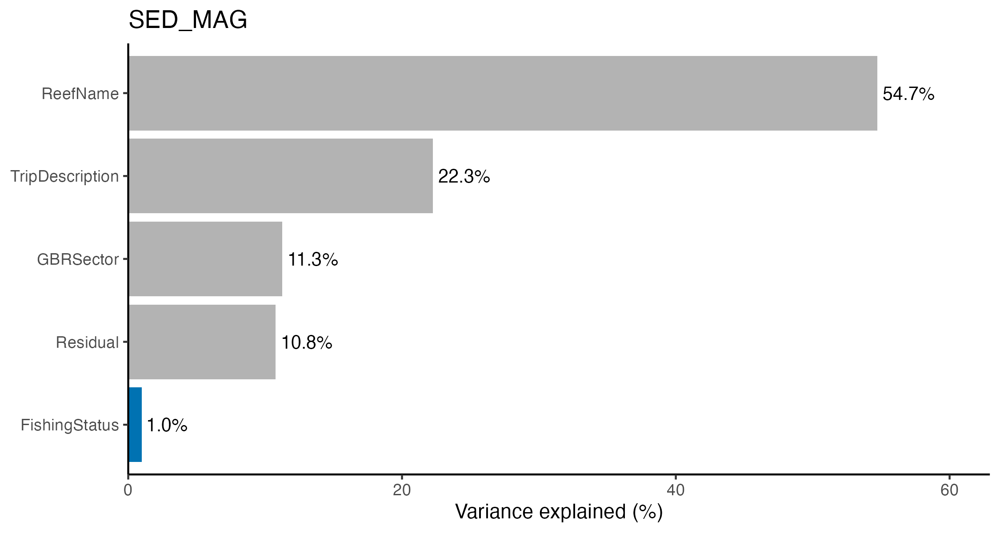<br>
      <b>(a)</b> Sediment, MAG-based (9,999 permutations)
    </td>
    <td align="center" width="50%" style="background-color: white;">
      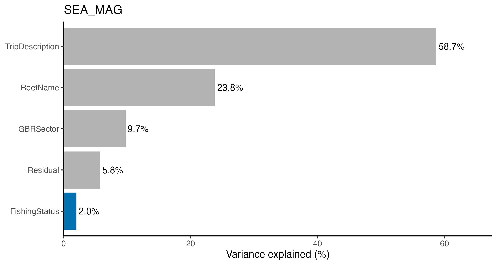<br>
      <b>(b)</b> Seawater, MAG-based (9,999 permutations)
    </td>
  </tr>
</table>

PERMANOVA on mOTU-based (SingleM) profiles
<table>
  <tr>
    <td align="center" width="50%" style="background-color: white;">
      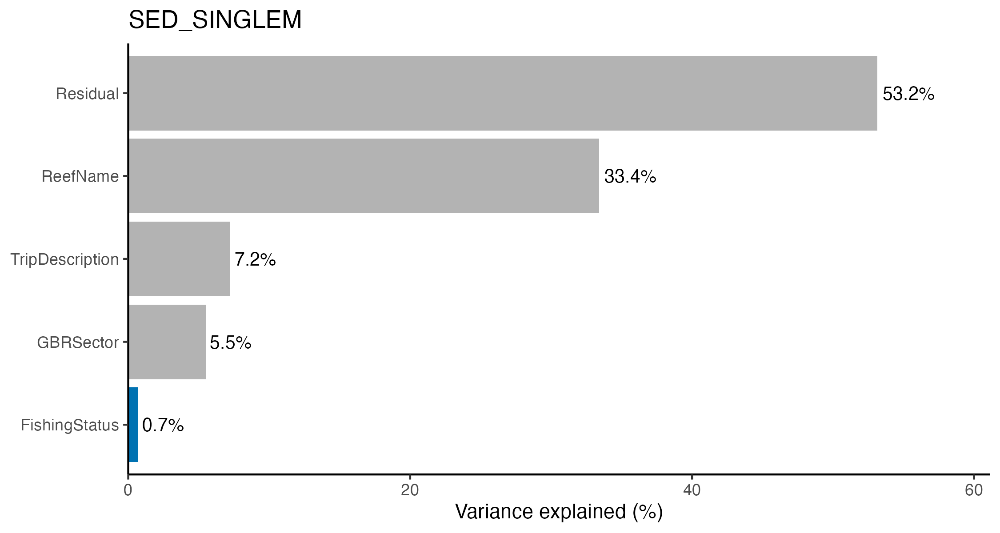<br>
      <b>(a)</b> Sediment, mOTU-based (9,999 permutations)
    </td>
    <td align="center" width="50%" style="background-color: white;">
      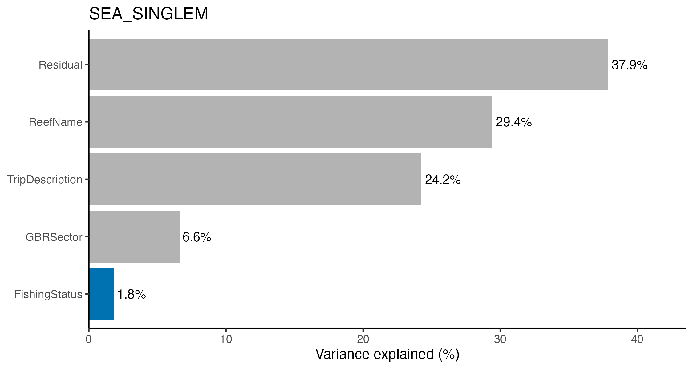<br>
      <b>(b)</b> Seawater, mOTU-based (9,999 permutations)
    </td>
  </tr>
</table>

## 3. MINT sPLS-DA <a name="mint"></a>
Directory: [`2_MINT_sPLSDA/`](2_MINT_sPLSDA/)

- MINT sPLS-DA in mixOmics v6.26.0 on CLR values, with GBR sector as the study variable
- Number of features per component tuned by leave-one-group-out cross-validation (LOGOCV, one sector left out at a time; 10 to 500 in steps of 10; up to five components; balanced error rate; centroids distance); final two-component model evaluated with the same scheme
- Performance: balanced accuracy (1 − balanced error rate); cross-validated AUC is reported from held-out predictions in [section 5](#roc)
- Direction of enrichment of each selected feature from the difference in mean CLR between NTMRs and fished reefs, overall and within each sector
- Platform: R (mixOmics)
- Output: Fig. S3b
- Script: [`6.03_mint_splsda.R`](scripts/6.03_mint_splsda.R)

Sediment sample plot from MINT sPLS-DA
<table>
  <tr>
    <td align="center" width="50%" style="background-color: white;">
      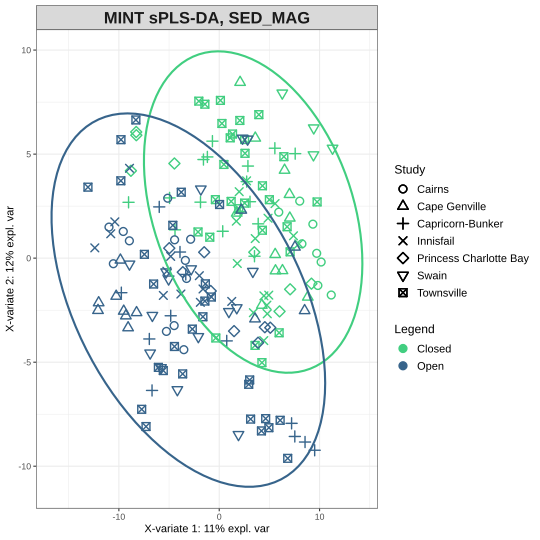<br>
      <b>(a)</b> mint_splsda_SED_MAG_global
    </td>
    <td align="center" width="50%" style="background-color: white;">
      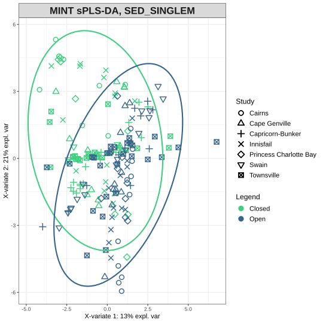<br>
      <b>(b)</b> mint_splsda_SED_SINGLEM_global
    </td>
  </tr>
</table>

Seawater sample plot from MINT sPLS-DA
<table>
  <tr>
    <td align="center" width="50%" style="background-color: white;">
      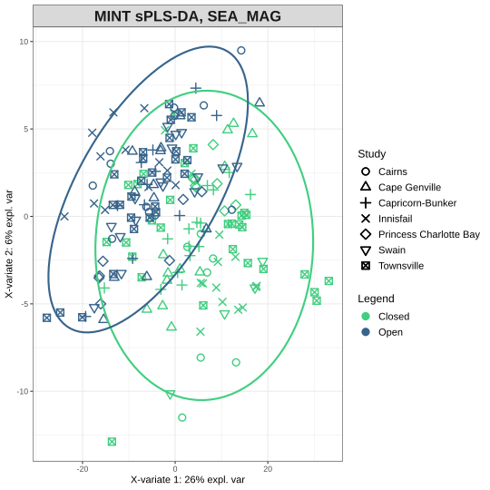<br>
      <b>(a)</b> mint_splsda_SEA_MAG_global
    </td>
    <td align="center" width="50%" style="background-color: white;">
      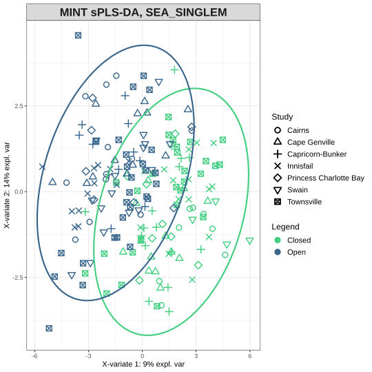<br>
      <b>(b)</b> mint_splsda_SEA_SINGLEM_global
    </td>
  </tr>
</table>

Indicator taxa from sediment MINT sPLS-DA
<table>
  <tr>
    <td align="center" width="50%" style="background-color: white;">
      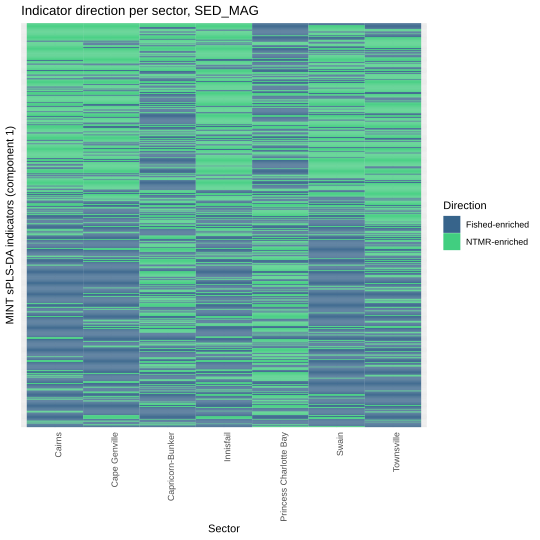<br>
      <b>(a)</b> indicators_by_sector_SED_MAG
    </td>
    <td align="center" width="50%" style="background-color: white;">
      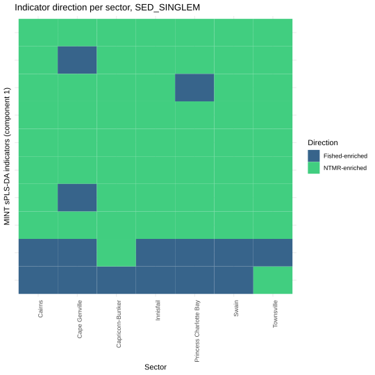<br>
      <b>(b)</b> indicators_by_sector_SED_SINGLEM
    </td>
  </tr>
</table>

Indicator taxa from seawater MINT sPLS-DA
<table>
  <tr>
    <td align="center" width="50%" style="background-color: white;">
      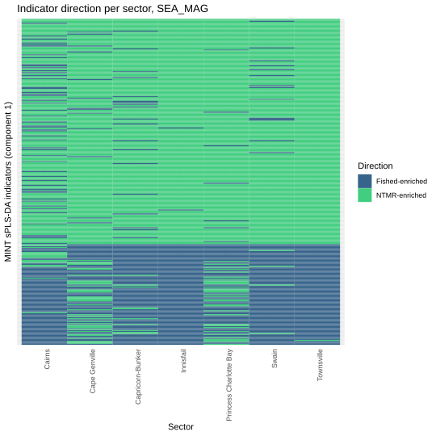<br>
      <b>(a)</b> indicators_by_sector_SEA_MAG
    </td>
    <td align="center" width="50%" style="background-color: white;">
      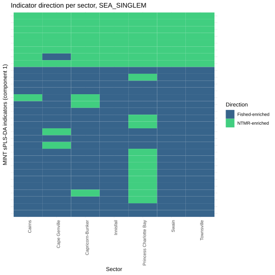<br>
      <b>(b)</b> indicators_by_sector_SEA_SINGLEM
    </td>
  </tr>
</table>


## 4. Permutation tests <a name="permutation"></a>
Directory: [`3_permutation_tests/`](3_permutation_tests/)

- Zoning status labels permuted 999 times among reefs within each GBR sector; the model is refitted with the tuned parameters and evaluated by LOGOCV to give a null distribution of balanced accuracy
- p = (number of null accuracies ≥ observed + 1) / (number of permutations + 1)
- Platform: R (mixOmics)
- Output: Fig. S3c (MAG-based) and Fig. S3d (mOTU-based)
- Script: [`6.04_mint_permutation.R`](scripts/6.04_mint_permutation.R)

Permutation test from sediment MINT sPLS-DA
<table>
  <tr>
    <td align="center" width="50%" style="background-color: white;">
      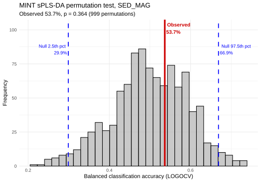<br>
      <b>(a)</b> permutation_mint_splsda_SED_MAG
    </td>
    <td align="center" width="50%" style="background-color: white;">
      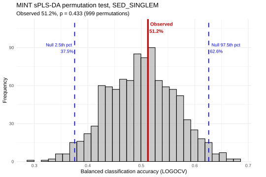<br>
      <b>(b)</b> permutation_mint_splsda_SED_SINGLEM
    </td>
  </tr>
</table>

Permutation test from seawater MINT sPLS-DA
<table>
  <tr>
    <td align="center" width="50%" style="background-color: white;">
      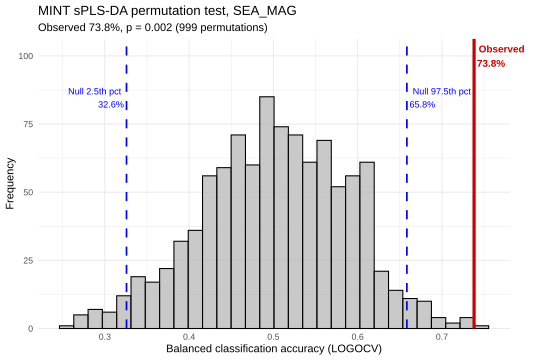<br>
      <b>(a)</b> permutation_mint_splsda_SEA_MAG
    </td>
    <td align="center" width="50%" style="background-color: white;">
      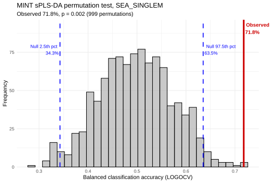<br>
      <b>(b)</b> permutation_mint_splsda_SEA_SINGLEM
    </td>
  </tr>
</table>


## 5. Cross-validated ROC <a name="roc"></a>
Directory: [`2_MINT_sPLSDA/`](2_MINT_sPLSDA/)

- Each GBR sector is held out in turn; MINT sPLS-DA is refitted on the remaining sectors with the tuned number of components and features per component (from 6.03), and the held-out sector is predicted as a new study (centroids distance)
- Score for each held-out sample: predicted value for NTMR (Closed) on component 1; held-out scores pooled across sectors
- ROC curve and AUC from the pooled held-out scores (NTMR as the positive class)
- Note: the number of features per component was tuned on all sectors, so the held-out sector is not fully independent of tuning
- Platform: R (mixOmics, pROC)
- Output: ROC curve (svg) and held-out scores per sample (xlsx)
- Script: [`6.05_mint_roc.R`](scripts/6.05_mint_roc.R)

Cross-validated ROC from sediment MINT sPLS-DA
<table>
  <tr>
    <td align="center" width="50%" style="background-color: white;">
      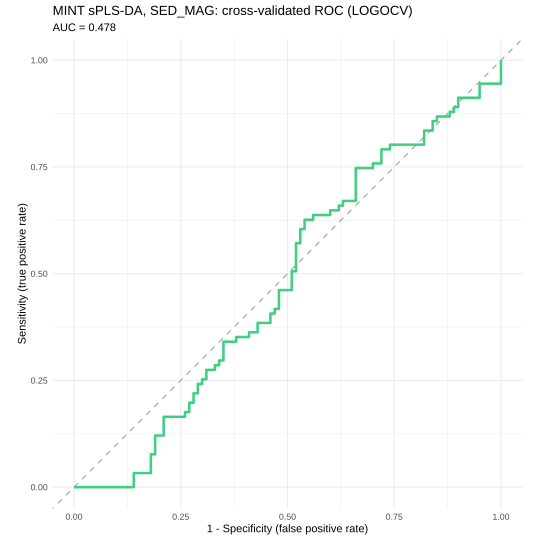<br>
      <b>(a)</b> mint_splsda_SED_MAG_LOGOCV_roc
    </td>
    <td align="center" width="50%" style="background-color: white;">
      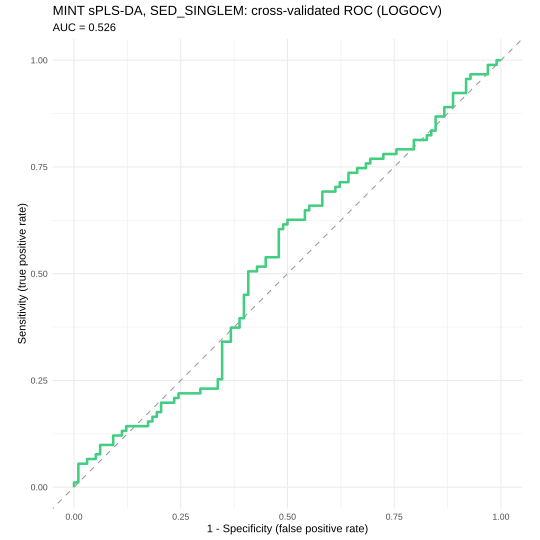<br>
      <b>(b)</b> mint_splsda_SED_SINGLEM_LOGOCV_roc
    </td>
  </tr>
</table>

Cross-validated ROC from seawater MINT sPLS-DA
<table>
  <tr>
    <td align="center" width="50%" style="background-color: white;">
      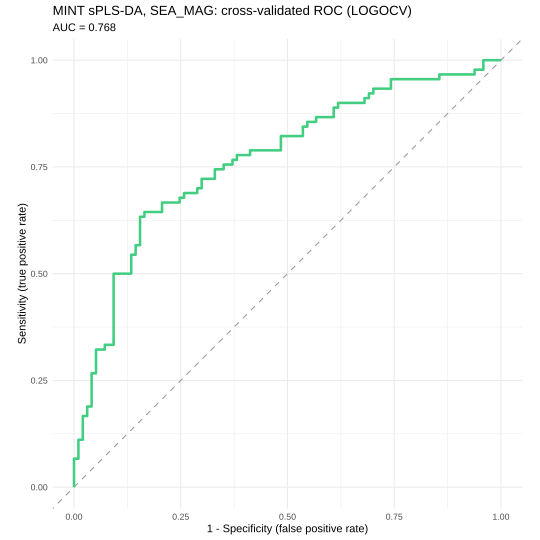<br>
      <b>(a)</b> mint_splsda_SEA_MAG_LOGOCV_roc
    </td>
    <td align="center" width="50%" style="background-color: white;">
      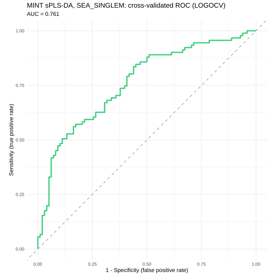<br>
      <b>(b)</b> mint_splsda_SEA_SINGLEM_LOGOCV_roc
    </td>
  </tr>
</table>