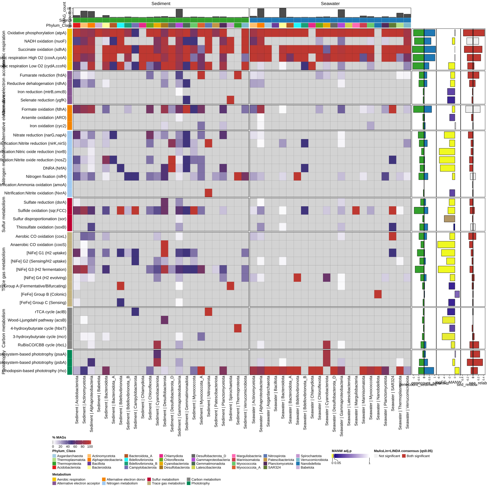

# Comparison of gene- and genome-centric analyses

**Aim:** compare what the gene-centric approach (SingleM mOTUs, and reads mapped to the protein catalogue) and the genome-centric approach (MAGs) reveal about sediment and seawater microbes, for taxonomic composition and for metabolic potential.

Related manuscript content: Fig. 3a-c, Fig. S2, Table S7.

Scripts for this analysis are in the [`scripts/`](scripts/) folder (`7.01` and `7.02`).

| Step | Script | Description |
|---|---|---|
| 7.01 | [`scripts/7.01_taxonomic_comparison.R`](scripts/7.01_taxonomic_comparison.R) | Sediment community composition from SingleM and CoverM: log2 fold changes, rank comparison, and class-level composition per reef |
| 7.02 | [`scripts/7.02_marker_gene_heatmap.R`](scripts/7.02_marker_gene_heatmap.R) | Metabolic marker genes and hydrogenase groups: % of MAGs per phylum, MAG enrichment, and gene-centric differential abundance |

## Table of contents
1. [Taxonomic composition](#taxonomy)
2. [Metabolic marker genes](#metabolism)

```bash
Rscript 3_combine/7_Gene_Genome_analysis/scripts/7.01_taxonomic_comparison.R   # after 6.01
Rscript 3_combine/7_Gene_Genome_analysis/scripts/7.02_marker_gene_heatmap.R    # after 2.16 and 5.08
```

## 1. Taxonomic composition <a name="taxonomy"></a>
Directory: [`1_taxonomy/`](1_taxonomy/)

- Gene-centric: SingleM mOTU profiles of sediment samples, scaled to estimated prokaryotic reads (see [SingleM](../../1_gene_centric/1_SingleM/1_SingleM.md)); genome-centric: CoverM read counts of the 1,201 sediment MAGs (see [MAG recovery](../../2_genome_centric/4_MAGs/4_MAG_recovery.md#mapping)); both prepared in [`6.01_prepare_profiles.R`](../6_Mixomics/scripts/6.01_prepare_profiles.R)
- Profiles summed per reef site and converted to relative abundance; taxa unclassified at a rank are excluded from the comparisons at that rank
- log2(CoverM / SingleM) of mean relative abundance at phylum, class, order, and family level, for taxa detected by both approaches (10 highest and 10 lowest shown); negative values indicate under-representation by CoverM
- Rank of mean relative abundance in each approach for the top 5 taxa of either approach; Spearman correlation of ranks
- Class-level composition (top 15 classes) per reef, by sampling trip and approach
- Mean relative abundance per sampling trip at class and family level
- Supporting (not reported): families detected by only one approach, correlation of family CLR values, and core families (present in ≥ 80% of samples)
- Platform: R (phyloseq, microViz)
- Output: Fig. S2a-d (log2 fold changes), Fig. S2e-h (ranks), Fig. S2i (composition), Table S7 (TODO: confirm which table)
- Script: [`7.01_taxonomic_comparison.R`](scripts/7.01_taxonomic_comparison.R)

<p align="center" style="background-color: white;">
  <a href="./1_taxonomy/FigS2i_class_composition.svg">
    
  </a>
  <br>
  <em> Relative abudance coverm vs singlem </em>
</p>

## 2. Metabolic marker genes <a name="metabolism"></a>
Directory: [`2_metabolism/`](2_metabolism/)

- Metabolic marker genes (Greening lab database) and HydDB hydrogenase subgroups, grouped into functions and metabolism categories; a function is present in a MAG if any of its genes is
- Genome-centric (796 MAGs with completeness ≥ 85%; [MAG annotation](../../2_genome_centric/5_MAGsAnnot/5_MAG_annotate.md), step 5.08):
  - % of MAGs encoding each function, per habitat and phylum (class for Pseudomonadota) (Fig. 3a)
  - Mean copy number per MAG in each habitat, and log2(seawater / sediment) fold change of mean copy number coloured by Mann-Whitney U adjusted p (Fig. 3b); negative values indicate enrichment in sediments
- Gene-centric (reads mapped to the protein catalogue; [Protein](../../1_gene_centric/2_Protein/2_Protein.md), step 2.16):
  - Mean relative abundance in each habitat, coloured red if MaAsLin2 and LinDA both give adjusted p ≤ 0.05 with the same direction (Fig. 3c)
- For functions with several genes: summed mean copy number, mean log2 fold change and lowest adjusted p, mean relative abundance, and significant if any gene is
- Side bars on a square-root scale
- Platform: R (ComplexHeatmap)
- Output: Fig. 3a-c
- Script: [`7.02_marker_gene_heatmap.R`](scripts/7.02_marker_gene_heatmap.R)


<p align="center" style="background-color: white;">
  <a href="../../2_genome_centric/5_MAGsAnnot/6_enrichment_tests/greening_mag_heatmap.withlegend.svg">
    
  </a>
  <br>
  <em> Heatmap enrichment. </em>
</p>