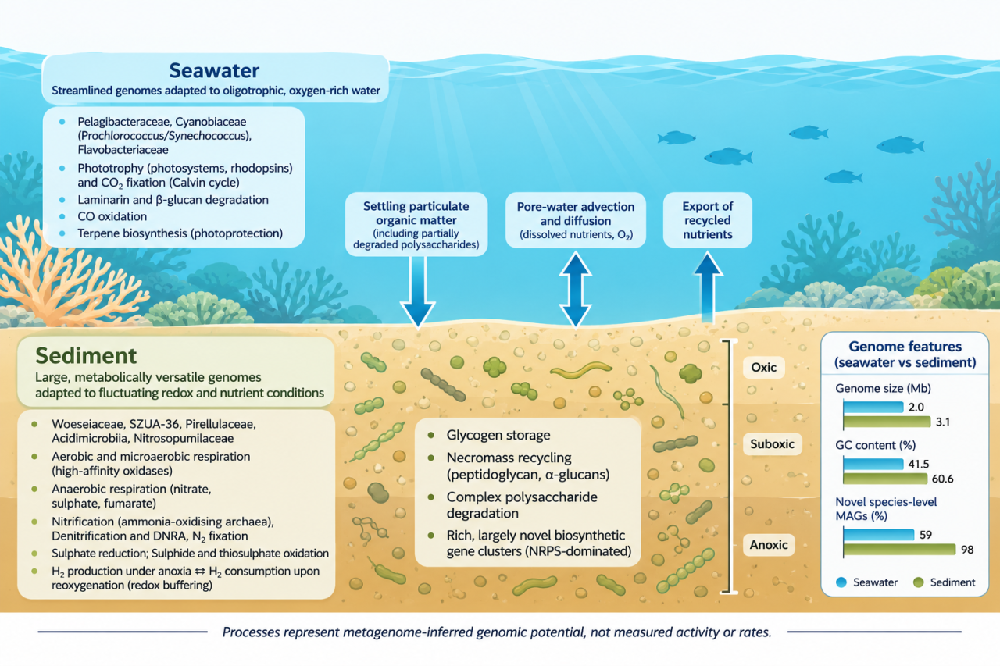

# Metagenomics analysis of sediment microbes across the Great Barrier Reef

This repository contains code and data associated with the paper:

> Ishida, H., Robbins, S. J., Bell, S. C., Lim, J. Y., Terzin, M., Webster, N., Bourne, D. G., Laffy, P. W., Hugenholtz, P., Yeoh, Y. K., & Chan, C. X. **Comparative metagenomics reveals diversity and metabolic heterogeneity of sediment microbes from the Great Barrier Reef.** *In preparation.*

  
   
  <em> Conceptual figure generated by Marko Terzin using Chat-gpt</em>

## Overview
This project implemented gene-centric and genome-centric analyses to investigate the taxonomic and metabolic diversity of surface sediment microbiomes of the Great Barrier Reef (GBR), relative to microbes in the co-located surface seawater ([Robbins et al., 2026](https://doi.org/10.1038/s41586-026-10778-z)). Sediments were collected from 48 reefs (23 no-take marine reserves and 25 fished reefs) across seven GBR sectors over four sampling trips (November 2019 to July 2020), yielding 191 Illumina metagenomes (17 with ONT long reads), 2,698 metagenome-assembled genomes (MAGs), and 1,201 species-level MAGs (MGD-sediment).

This project is part of the Great Barrier Reef Microbial Genomes Database sub-Facility within the Marine Microbiome Initiative Facility of Australia's Integrated Marine Observing System (IMOS). More details are available on the [IMOS GBR Microbial Genomic Database page](https://imos.org.au/facilities/marinemicrobiomeinitiative/gbr-microbial-genomic-database).

More details for the seawater data analysed alongside sediments (MGD-seawater) are available on Dr Marko Terzin's GitHub pages and on [Zenodo](https://zenodo.org/records/20503966):
- [Gene-centric analyses](https://github.com/mterzin/IMOS_GBR_MGD_read-centric_analysis) associated with [Terzin et al., 2025](https://doi.org/10.1186/s40168-024-01972-0)
- [Genome-centric analyses](https://github.com/mterzin/fishy_microbes) associated with [Terzin et al., 2026](https://doi.org/10.64898/2026.07.23.740257) and [Robbins et al., 2026](https://doi.org/10.1038/s41586-026-10778-z)

## Repository structure
Each analysis folder has its own page describing the methods, and its scripts are in a `scripts/` subfolder, numbered by analysis (e.g. `4.01` is the first step of `4_MAGs`).

### [`0_metadata/`](0_metadata/): samples, sequencing, and QC ([page](0_metadata/0_sample_data_qc.md))
- 192 sediment samples, 48 reefs, zoning status, and sampling trips
- Illumina and ONT library preparation and sequencing yield
- Adapter removal with fastp and porechop
- [`1_Sampling/`](0_metadata/1_Sampling/): field photographs

### [`1_gene_centric/`](1_gene_centric/): read-based analyses

#### [`1_SingleM/`](1_gene_centric/1_SingleM/): mOTU-based analyses ([page](1_gene_centric/1_SingleM/1_SingleM.md); scripts `1.01` to `1.07`)
- [`1_community_profiles/`](1_gene_centric/1_SingleM/1_community_profiles/): SingleM pipe on reads subsampled to 10 M read pairs, phyloseq objects, habitat PCA and Shannon diversity (Fig. 1d)
- [`2_ordination_PERMANOVA/`](1_gene_centric/1_SingleM/2_ordination_PERMANOVA/): PCA by trip and sequential and reef-level PERMANOVA (Fig. 1g-h)
- [`3_abundance_DA/`](1_gene_centric/1_SingleM/3_abundance_DA/): community composition (Fig. 1c), MaAsLin2 and LinDA, sediment vs seawater (Table S4), and family-level abundance and prevalence (Tables S5 and S6)
- [`4_appraise_novelty/`](1_gene_centric/1_SingleM/4_appraise_novelty/): SingleM appraise against assemblies, MAGs, and GTDB R10-RS226

#### [`2_Protein/`](1_gene_centric/2_Protein/): non-redundant protein analyses ([page](1_gene_centric/2_Protein/2_Protein.md); scripts `2.01` to `2.16`)
- [`1_gene_catalogue/`](1_gene_centric/2_Protein/1_gene_catalogue/): Prodigal ORFs clustered with MMseqs2 easy-linclust (39.2 M non-redundant proteins)
- [`2_annotation/`](1_gene_centric/2_Protein/2_annotation/): KOfam (DRAM), CAZymes (run_dbcan), hydrogenases (HydDB), 44 marker genes, and *amoA* (GraftM; Table S17)
- [`3_read_mapping_RPKM/`](1_gene_centric/2_Protein/3_read_mapping_RPKM/): DIAMOND blastx, RPKM normalised to SingleM marker genes, and PCoA (Fig. 1e-f)
- [`4_differential_abundance/`](1_gene_centric/2_Protein/4_differential_abundance/): MaAsLin2 and LinDA on functional profiles (Fig. 3c)

#### [`3_Sylph/`](1_gene_centric/3_Sylph/): k-mer-based analyses ([page](1_gene_centric/3_Sylph/3_Sylph.md); scripts `3.01` to `3.03`)
- Supporting analysis; not reported in the manuscript
- [`1_summary/`](1_gene_centric/3_Sylph/1_summary/): sylph profiles against GTDB R10-RS226, with PCA, Shannon diversity, and composition plots

### [`2_genome_centric/`](2_genome_centric/): MAG-based analyses

#### [`4_MAGs/`](2_genome_centric/4_MAGs/): MAG recovery, QC, dereplication, taxonomy, novelty, and read mapping ([page](2_genome_centric/4_MAGs/4_MAG_recovery.md); scripts `4.01` to `4.16`)
- [`1_assembly_recovery/`](2_genome_centric/4_MAGs/1_assembly_recovery/): Aviary assemble (17 hybrid and 174 Illumina-only assemblies), selection of binning datasets with SingleM appraise, Aviary recover multi-sample binning, and BinChicken co-assembly (71 co-assemblies) (Table S2, Fig. 1b)
- [`2_MAG_QC_Dereplication/`](2_genome_centric/4_MAGs/2_MAG_QC_Dereplication/): CheckM and CheckM2, quality score ≥ 50% (2,698 MAGs; Table S7), CoverM cluster at 95% ANI (1,201 MAGs; Table S8), and genome features (Fig. 2e-g)
- [`3_taxonomy_novelty/`](2_genome_centric/4_MAGs/3_taxonomy_novelty/): GTDB-Tk R10-RS226 and PhyloRank curation (Fig. S1), IQ-TREE bacterial and archaeal trees (Fig. 2a-b), MAGs per phylum (Fig. 2b), and comparison with GTDB and public genome collections (Table 1, Fig. 2c-d)
- [`4_read_mapping/`](2_genome_centric/4_MAGs/4_read_mapping/): CoverM read mapping of each habitat to its own MAGs (MAG-based community profiles)
- [`5_unbinned_contigs/`](2_genome_centric/4_MAGs/5_unbinned_contigs/): MMseqs2 taxonomy of all assembled contigs, and an exploratory analysis of unbinned contigs (not reported in the manuscript)

#### [`5_MAGsAnnot/`](2_genome_centric/5_MAGsAnnot/): MAG annotation ([page](2_genome_centric/5_MAGsAnnot/5_MAG_annotate.md); scripts `5.01` to `5.14`)
- [`1_DRAM/`](2_genome_centric/5_MAGsAnnot/1_DRAM/): KOfam, Pfam, and MEROPS annotation
- [`2_CAZymes_CGCs/`](2_genome_centric/5_MAGsAnnot/2_CAZymes_CGCs/): run_dbcan CAZymes, CGCs, and dbCAN-PUL substrates (Fig. 4, Table S20)
- [`3_sulphatases/`](2_genome_centric/5_MAGsAnnot/3_sulphatases/): SulfAtlas
- [`4_hydrogenases_marker_genes/`](2_genome_centric/5_MAGsAnnot/4_hydrogenases_marker_genes/): HydDB and 44 metabolic marker genes (Fig. 3a-b, 3d; Table S16)
- [`5_amoA/`](2_genome_centric/5_MAGsAnnot/5_amoA/): GraftM *amoA* detection and clade assignment (Table S18)
- [`6_enrichment_tests/`](2_genome_centric/5_MAGsAnnot/6_enrichment_tests/): Mann-Whitney U tests on 796 MAGs (Tables S10 to S15, S19), and marker gene enrichment between sediment and seawater MAGs
- [`7_BGCs/`](2_genome_centric/5_MAGsAnnot/7_BGCs/): antiSMASH, clust-o-matic GCFs, and MIBiG and BiG-FAM novelty (Fig. 5, Tables S21 and S22)

### [`3_combine/`](3_combine/): combined gene- and genome-centric analyses

#### [`6_Mixomics/`](3_combine/6_Mixomics/): reef zoning status analyses ([page](3_combine/6_Mixomics/6_Mixomics.md); scripts `6.01` to `6.10`)
- Sequential PERMANOVA on MAG-based profiles (Fig. S3a)
- MINT sPLS-DA tuning, final models, and indicator MAGs (Fig. S3b)
- Reef-level permutation nulls for MAG and mOTU profiles (Fig. S3c-d)

#### [`7_Gene_Genome_analysis/`](3_combine/7_Gene_Genome_analysis/): gene- vs genome-centric comparison ([page](3_combine/7_Gene_Genome_analysis/7_Gene_Genome_analysis.md); scripts `7.01` and `7.02`)
- Relative abundance compared across taxonomic ranks and sampling trips (Fig. S2, Tables S5 and S9)
- Heatmap of metabolic marker genes from gene- and genome-centric profiles

### Other folders
- [`4_results/`](4_results/): final figures and tables
- [`scripts/`](scripts/): shared helpers (`PATH.R`, `reorganise_scripts.py`)
- [`archive/`](archive/): earlier versions of this repository; not maintained

## Data availability

Raw sequencing data and sediment MAGs will be released upon publication.

| Data | Location |
|---|---|
| Raw sequencing reads (Illumina and ONT) | IMOS-AODN (`TODO`) and ENA (`TODO`) |
| Sediment MAGs (MGD-sediment) | Zenodo (`TODO`) |
| Seawater MAGs (MGD-seawater) | <https://zenodo.org/records/20503966> |

## Authors and affiliations

Hisatake Ishida1, Steven J. Robbins1, Sara C. Bell2, Jin Yan Lim2, Marko Terzin2,4,5, Nicole Webster1,3, David G. Bourne2,4,5, Patrick W. Laffy2,5, Philip Hugenholtz1, Yun Kit Yeoh2,5, Cheong Xin Chan1

1. Australian Centre for Ecogenomics, School of Chemistry and Molecular Biosciences, The University of Queensland, Brisbane, QLD 4072, Australia
2. Australian Institute of Marine Science, Townsville, QLD 4810, Australia
3. Institute for Marine and Antarctic Studies, University of Tasmania, Hobart, TAS 7001, Australia
4. College of Science and Engineering, James Cook University, Townsville, QLD 4811, Australia
5. AIMS@JCU, James Cook University, Townsville, QLD 4811, Australia

## Questions or issues

Please contact Hisatake Ishida at hisatake.ishida@uq.net.au, or open an [issue](../../issues).